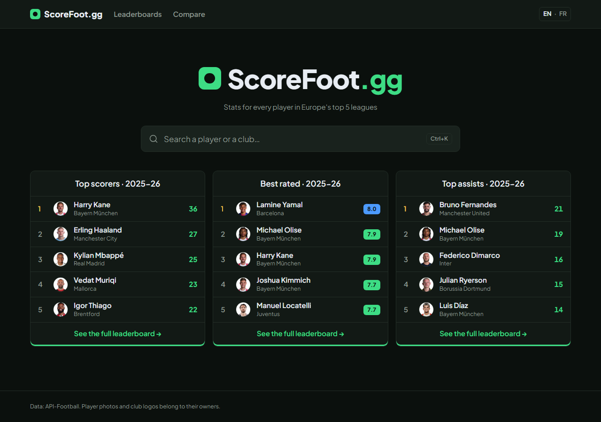
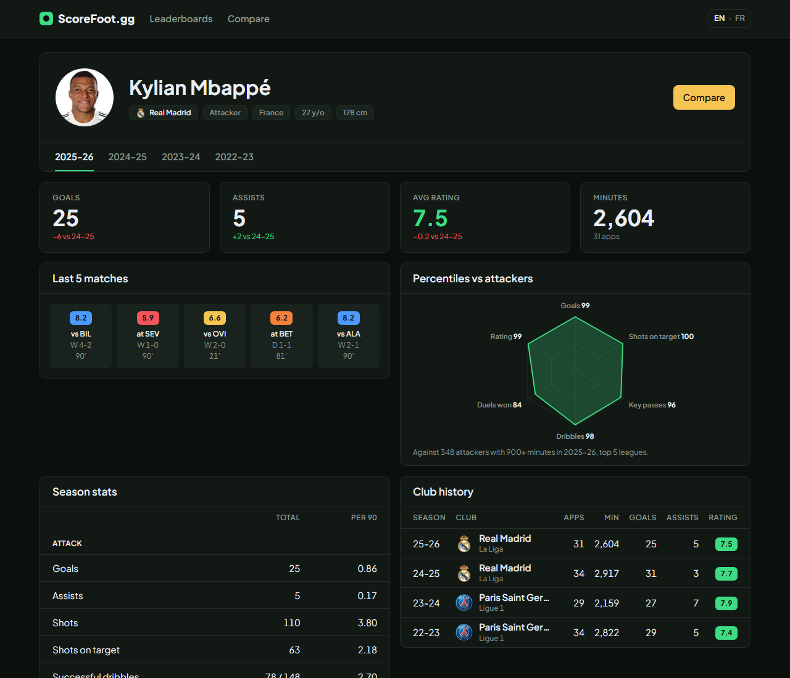
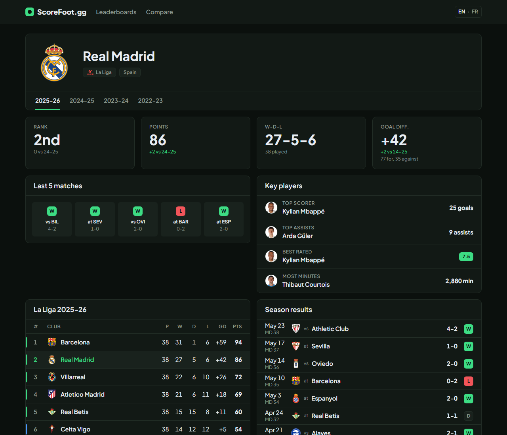
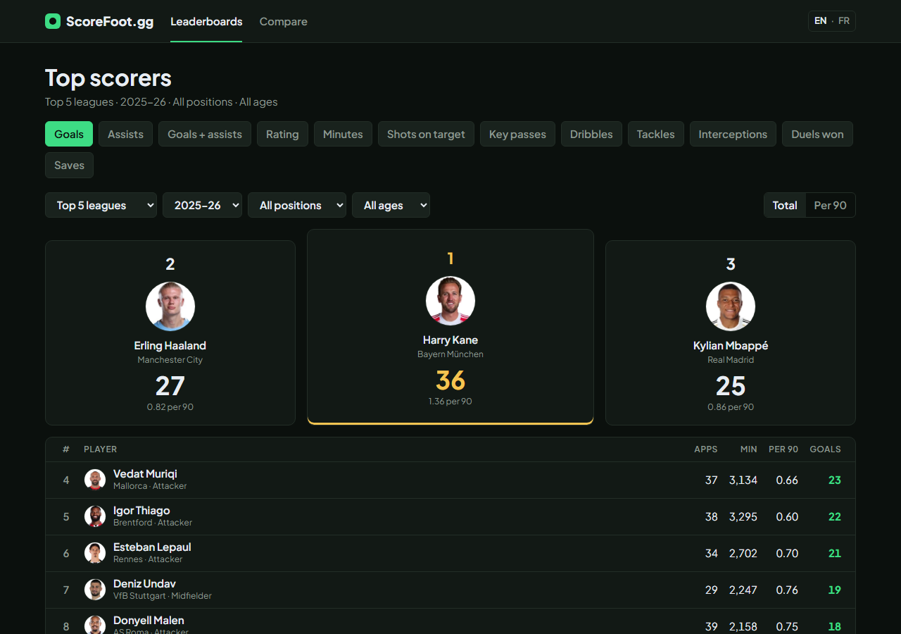
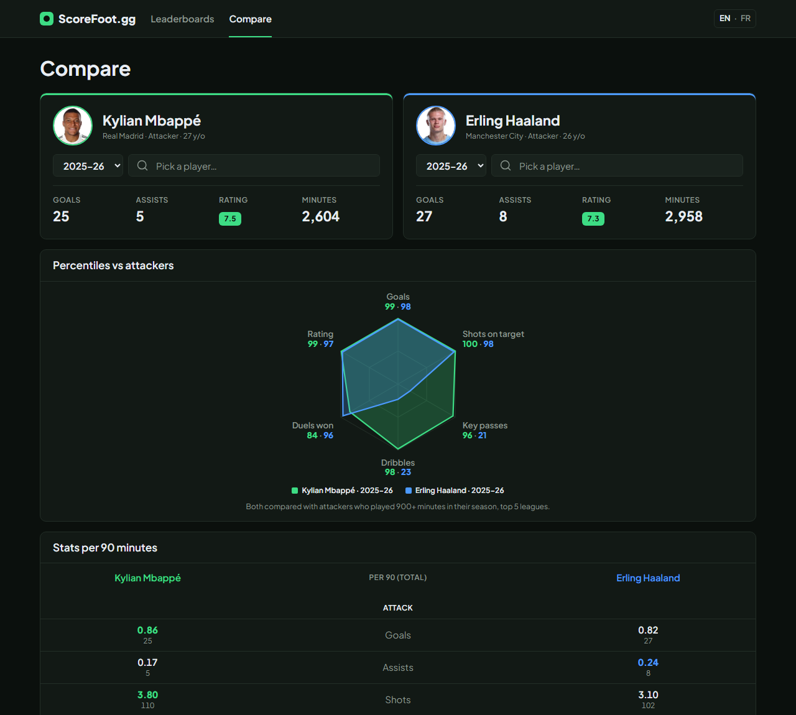
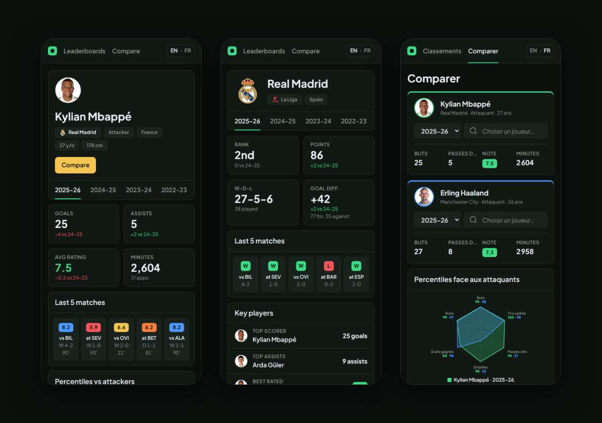
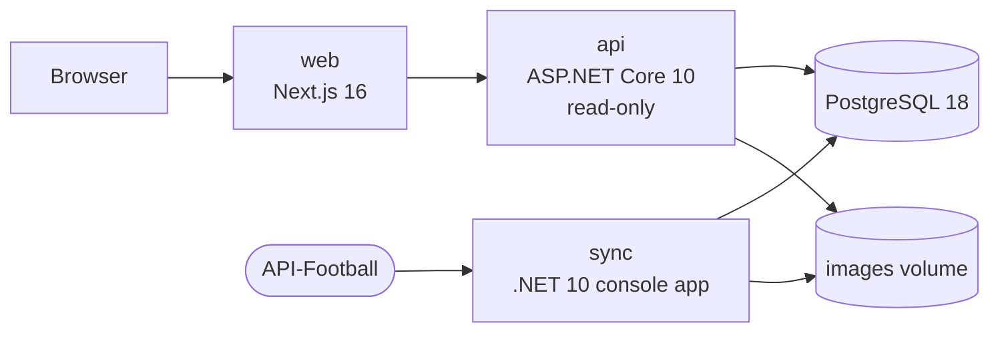

# ScoreFoot.gg

**Search any player or club from Europe's top 5 leagues and read their stats at a glance.**

<p align="center">
  
</p>

ScoreFoot.gg is a football stats site inspired by [dpm.lol](https://dpm.lol): one search bar, then dense, readable pages. It covers the Premier League, La Liga, Serie A, Bundesliga and Ligue 1 over four complete seasons (2022-23 to 2025-26), in English and French.

It is a portfolio project, built end to end: data pipeline, read-only API, server-rendered web app, tests and Docker.

## Features

### Player page
Season numbers with the change from last season, the last 5 matches with their ratings, a percentile radar against players of the same position, per-90 stats and the club history.



### Club page
League position, form, key players, the full league table with qualification and relegation zones, every result of the season and the squad.



### Leaderboards
12 stats (goals, assists, rating, dribbles, tackles…), in total or per 90 minutes, filtered by league, season, position and age, with a podium for the top 3.



### Compare
Two players side by side, each on the season you choose: key numbers, overlaid percentile radars and per-90 stats where the better value stands out.



### Mobile and bilingual
Every page works at 390 px wide, in English and French. Search tolerates typos and accents (`odegaard` finds Martin Ødegaard).



## How it works



- **Data is downloaded once.** The `sync` app fetched about 1,300 API-Football answers within the daily quota, resuming where it stopped, and stored them with every player photo and club logo. The site never calls API-Football while you browse.
- **The API is read-only and computes on demand:** season totals, percentiles per position and leaderboards come straight from the stored match and season lines, in under 100 ms.
- **The browser only talks to `web`:** pages are rendered on the server, images are served from our own domain, and there are no cookies, analytics or third-party requests.

## Tech stack

| Area | Tools |
|---|---|
| Web | Next.js 16 (App Router), React 19, TypeScript, Tailwind CSS 4, next-intl |
| API | ASP.NET Core 10 Minimal API, Entity Framework Core 10, Npgsql |
| Data | PostgreSQL 18 with `pg_trgm` for fuzzy search |
| Sync | .NET 10 console app, quota-aware task queue |
| Tests | xUnit (132 tests), Vitest (86), Playwright (78, Chrome and Firefox) |
| Run | Docker Compose, non-root containers |

More in [docs/ARCHITECTURE.md](docs/ARCHITECTURE.md).

## Run it locally

Requirements: Docker Desktop, and an [API-Football](https://www.api-football.com/) key for the first data download.

```
cp .env.example .env               # then fill in the values
docker compose up -d db
docker compose run --rm sync run   # downloads the data (stops at the daily budget, run again to resume)
docker compose up -d --build       # db, api and web
```

Open http://localhost:3000.

## Tests

```
cd server && dotnet test --solution ScoreFoot.sln   # C# (needs the db)
cd web && npm test                                   # Vitest
cd web && npx playwright test                        # end-to-end, Chrome + Firefox
```

## Docs

- [docs/PRD.md](docs/PRD.md): what the product is and is not
- [docs/DESIGN_SYSTEM.md](docs/DESIGN_SYSTEM.md): colours, type, components
- [docs/ARCHITECTURE.md](docs/ARCHITECTURE.md): stack, data flow, privacy
- [docs/deployment-checklist.md](docs/deployment-checklist.md): before a public launch
- [specs/](specs/): one spec per feature

## Credits

- Data: [API-Football](https://www.api-football.com/). Player photos and club logos belong to their owners.
- Font: [Plus Jakarta Sans](https://github.com/tokotype/PlusJakartaSans) (SIL Open Font License).
